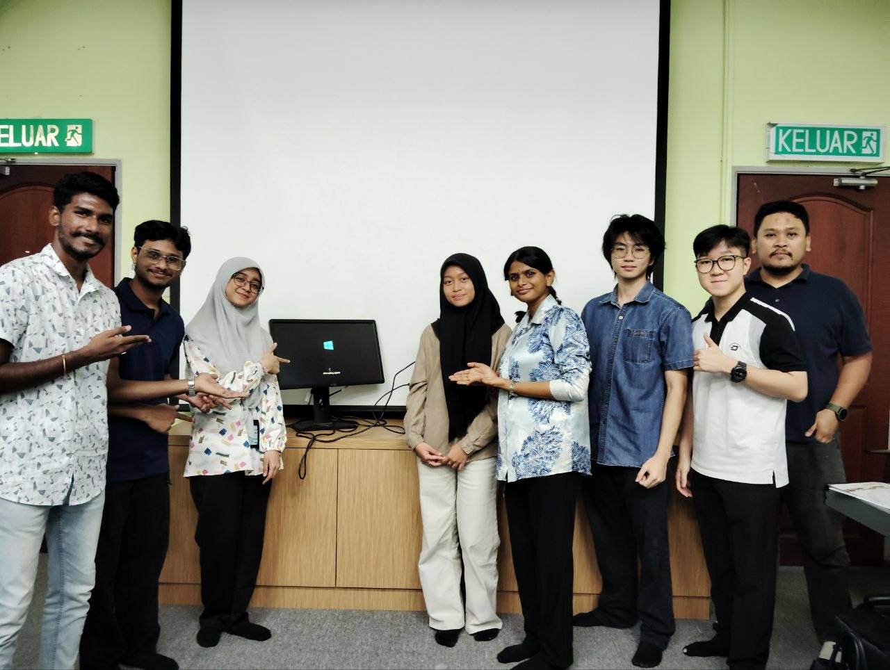

# What I Learned from the PC Assembly Session

On 10 November 2026, I had the opportunity to attend the PC Assembly Session.

During the session, I learned how to check and identify the internal components of a computer, as well as the step-by-step process of disassembling and reassembling a PC.

During the PC Assembly, the technicians taught us the structured disassembly process. We learned that we must first shut down the PC, open the case, remove all the wiring, and carefully take out components including the power supply, RAM, hard disk, and fan. It made me realise how crucial safety, care, and systematic handling are when working directly with computer hardware.

I also learned that reassembling a computer requires method and precision. We had to install every component back in the proper order and test the computer afterward to make sure it was fully functioning.

As a computing student, I think these practical skills are important, especially when diagnosing hardware issues and understanding how physical components interact. Instead of just reading about computer hardware theoretically, I learned to physically inspect, build, and verify system functionality.

Overall, this session reminded me that gaining hands-on hardware experience is just as important as mastering software skills. I hope to apply what I learned in my studies and future technical projects.

